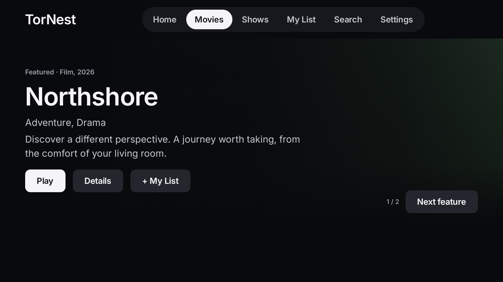
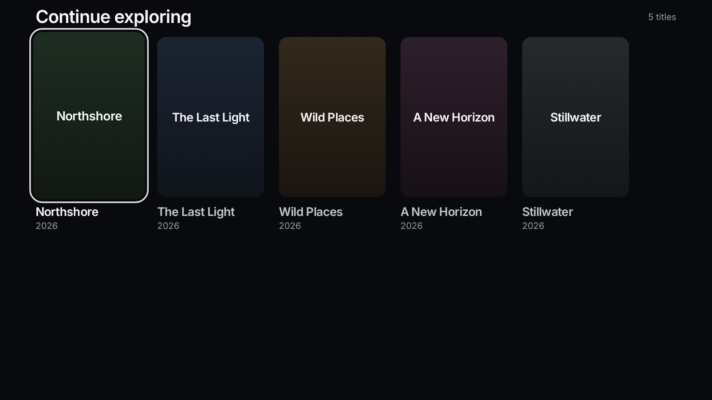

# TorNest - Movie and TV streaming for Fire TV and Android TV

TorNest brings movies and TV shows to your living room, with an app you can use from your TV remote. Browse the catalogue, save something for later, or carry on with the episode you started last night.

It's a BitTorrent streaming app for Android-based Fire TV, Android TV, and Google TV. You don't need to leave a computer running or set up a separate media server to watch.

**[Visit the TorNest website](https://davidsamir.github.io/TorNest/) | [Download TorNest](https://github.com/DavidSamir/TorNest/releases) | [Installation guide](https://davidsamir.github.io/TorNest/install.html)**

*Preview of the new interface using a sample title and placeholder artwork. Check the release notes to see which interface is included in your download.*

## What is TorNest like to use?

Everything starts with your remote. Move through movies and shows, look up a title, and open its details before deciding what to watch. The dark layout keeps the screen easy to read, with rounded posters and a clear outline around the item you've selected.

When you find something interesting, add it to **My List**. If you stop halfway through, **Continue Watching** keeps your place on that TV. For a series, you can browse seasons and episodes and choose whether the next episode starts automatically.

TorNest can start playing while a video is still downloading. How quickly it starts depends on your connection and whether other people are sharing that video.

*Browsing preview with illustrative titles and placeholder artwork.*

## Can I use TorNest on my TV?

TorNest is built for Android-based Amazon Fire TV and Fire TV Stick devices, Android TV, and Google TV. Support depends on the particular device, so check the [compatibility guide](https://davidsamir.github.io/TorNest/compatibility.html) before downloading.

## Where do I download TorNest?

Get the app from [TorNest releases on GitHub](https://github.com/DavidSamir/TorNest/releases). Each release has its own download and notes about what's changed. Older downloads may still use the name Torfilx.

If this is your first time installing an app this way, follow the [TV installation guide](https://davidsamir.github.io/TorNest/install.html).

## A few things to know before watching

TorNest streams from people sharing video. A title can appear in the catalogue even when nobody is available to share it, so playback isn't guaranteed for every listing.

Sharing can also send parts of a video to other people and make your internet address visible to them. The app asks before you enable it. Only watch and share content you have permission to use.

## Need a hand?

Start with the [help page](https://davidsamir.github.io/TorNest/troubleshooting.html), or [tell us what went wrong](https://github.com/DavidSamir/TorNest/issues). Let us know which TV you're using and what you were trying to do.

For detailed setup instructions and build commands, see the [setup guide](docs/SETUP.md). The [developer guide](docs/DEVELOPMENT.md) covers how the project works.

## Contributing

Found a bug, spotted something confusing, or have an idea that would make TorNest better? We'd like to hear it. Read the [contribution guidelines](CONTRIBUTING.md) before opening an issue or sending a change.
